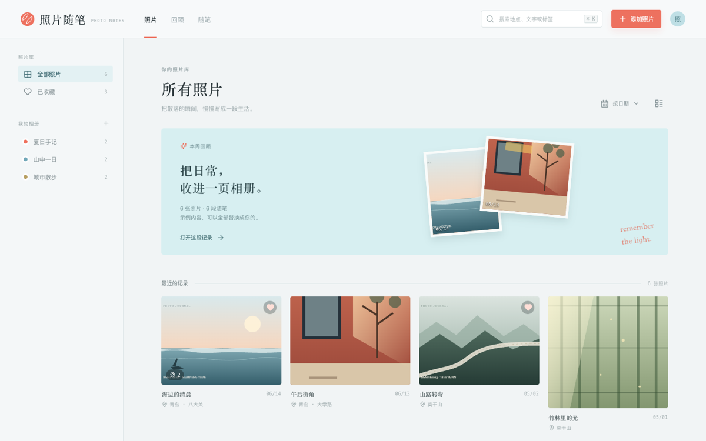

# 记忆随笔 · Memory Journal

[English](README.md) · **简体中文**

一个用 React + Vite 写的本地优先照片随笔模板：浏览相册、打开照片、在旁边写一段话、加标注、在图片上画线。示例文案是虚构的，示例照片只用于展示版式；文案与标注集中在 `src/sample-content.js`，整段替换成你自己的内容即可。



在线预览：<https://ryankiinovo.github.io/memory-journal/>

## 包含什么

- 照片网格：相册、收藏、搜索、按时间的回顾视图
- 照片编辑器：三种布局、图片标注、自由画笔、随笔与标签
- 随笔视图：集中展示所有写过文字的照片
- 使用 `localStorage` 的本地优先存储
- 8 张 JPG 示例照片，只用于展示版式
- 响应式布局，无后端、无 API Key

## 快速开始

```bash
npm install
npm run dev      # http://localhost:5173
npm run build    # 产物在 dist/
npm run preview
```

需要 Node.js 20 或更新版本。

## 目录

```text
.
├── index.html
├── package.json
├── vite.config.js
├── public/photos/       # 示例 JPG 图片（替换成你自己的）
└── src/
    ├── main.jsx         # 应用与组件
    ├── sample-content.js # 示例文案（虚构，整段可替换）
    └── styles.css
```

## 改成你的相册

1. 把 `public/photos/` 里的文件换成你的照片；保留文件名，或同步修改 `src/sample-content.js` 里的 `src`。
2. 只改 `src/sample-content.js`：标题、日期、地点、相册、随笔、标签与标注都集中在这一个文件里；可以增减条目，页面会自动适配。
3. 修改 `Logo` 组件和 `index.html` 里的品牌名。
4. 在 `src/styles.css` 的 `:root` 里调整配色。

示例文案目前是虚构的，只用于演示版式；换成真实文案前，请确认你有权公开对应的照片与文字。页面首次加载会把示例数据写进 `localStorage`，替换文案后若仍看到旧内容，清掉该站点的本地存储，或修改 `src/main.jsx` 里的 `memory-journal-v1` key。

上传文件只通过 `URL.createObjectURL` 在本地预览，不会上传到任何服务器；刷新页面后 blob URL 会失效。如果需要持久化，请把 `seedPhotos` 换成自己的存储层。

## 部署

`npm run build` 生成静态 `dist/`。`vite.config.js` 设置了 `base: './'`，因此可以部署在 GitHub Pages 这类子路径下，也可以放到任意静态托管。

## 隐私与素材

模板不包含统计脚本、Cookie，也不会向应用后端发请求。示例照片与文案只用于演示界面，不是个人相册。复用模板时，请替换 `public/photos/` 和 `src/sample-content.js`，并确认你有权公开每一张图片与每一段文字。

## 许可证

MIT，见 `LICENSE`。
